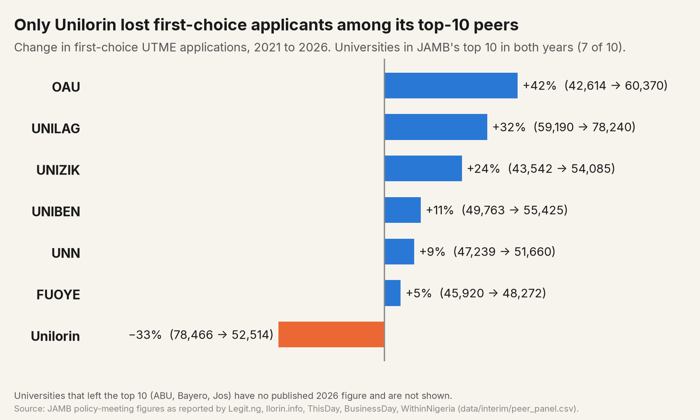
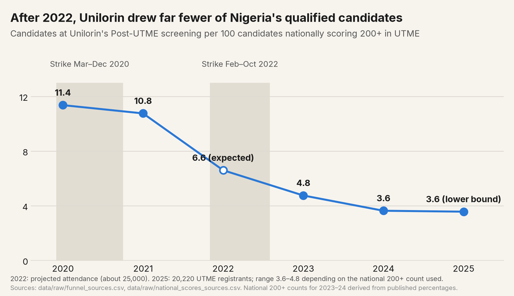

# From first choice to fading choice: UTME demand for the University of Ilorin, 2020–2026

For years the University of Ilorin was the institution named most often as first choice in Nigeria's Unified Tertiary Matriculation Examination (UTME). This project rebuilds the number of candidates who chose it first in each UTME year from 2020 to 2026, using figures published by the Joint Admissions and Matriculation Board (JAMB) as reported in the press. It records every figure with its source, accepts a value only when independent sources agree, compares the University of Ilorin with peer universities, and tests which explanations for the change public data can support or rule out.

## Research questions

1. How much did first-choice UTME demand for the University of Ilorin change from 2020 to 2026, in number and as a share of all candidates?
2. Is the change specific to the University of Ilorin compared with its peers?
3. Where are candidates lost between first choice, the 180 cut-off, Post-UTME screening and admission?
4. Which explanations can public data support or rule out: new universities nearby, insecurity in Kwara, cost, admission rules, changing search interest?

## Headline result so far

First-choice applications to the University of Ilorin fell from 103,582 in 2020 to 52,514 in 2026, a fall of 49.3%. Its share of all applicants fell from 5.31% to 2.34%, and it dropped from first place (2018–2024) to seventh (2026).

Seven universities were in JAMB's top 10 in both 2021 and 2026. Of these, only the University of Ilorin had fewer first-choice applications in 2026 than in 2021: 78,466 down to 52,514 (−33%). The other six rose by between 5% (Federal University Oye-Ekiti) and 42% (Obafemi Awolowo University). Universities that left the top 10 have no published 2026 figure, so they are not part of this comparison.



After 2021 the University of Ilorin also drew fewer of the country's qualified candidates to its own screening: candidates at its Post-UTME screening fell from 10.8 per 100 candidates nationally scoring 200 or more in 2021 to 3.6 in 2024.



Figure 2: Post-UTME screening at the University of Ilorin per 100 candidates nationally scoring 200 or more, 2020–2025, with the 2020 and 2022 strikes shaded.

First-choice figures for 2022 are not established: no source prints a comparable University of Ilorin value for that year. See [docs/phase1_notes.md](docs/phase1_notes.md) for the series, the acceptance rule and the conflicts found in published figures.

## Repository map

```
assets/
  fonts/                Inter typeface used in the figures (SIL Open Font License)
data/
  raw/                  figures copied as printed, one row per source and value
    applicants_sources.csv        first-choice applicants by institution and UTME year
    funnel_sources.csv            Post-UTME screening, admission and matriculation, University of Ilorin
    national_scores_sources.csv   national UTME score bands
    national_totals_sources.csv   national UTME totals by year and measure
    strike_events.csv             strikes at the University of Ilorin and comparison universities
  interim/              values derived from data/raw by src/first_choice
    peer_panel.csv                    institution-year panel
    unilorin_first_choice_series.csv  University of Ilorin series, 2018–2026
    funnel_by_year.csv                first choice to matriculation, 2018–2026
    national_200plus.csv              national candidates scoring 200+
    screening_index.csv               screened per 100 national 200+ candidates
    unilorin_share_180plus.csv        share of national 180+ candidates, 2020–2021
docs/
  phase1_notes.md       Phase 1 notes: sources, rule, series, problems found
  phase2_notes.md       Phase 2 notes: funnel, national scores, strikes
  project_plan.md       research questions, data, methods, phases, limitations
  source_log.md         every source_id with outlet, URL and publication date
figures/
  fig1_change_2021_2026.png/.svg
  fig2_screening_share.png/.svg
src/first_choice/
  series.py             first-choice series and peer panel
  funnel.py             funnel, national 200+ counts, screening index
  figures.py            figures 1 and 2
tests/
  test_series.py
  test_funnel.py
```

## Reproduce

Set up the environment once:

```
python -m venv .venv
.venv/Scripts/activate        # Windows; on macOS/Linux: source .venv/bin/activate
pip install -e ".[dev]"
```

Then run, in order:

```
python -m first_choice.series    # checks the first-choice tables against data/interim (--write regenerates them)
python -m first_choice.funnel    # writes the funnel, national 200+ and screening index tables
python -m first_choice.figures   # redraws figures/ from data/interim
pytest
```

The acceptance rule is stated in the docstring of `src/first_choice/series.py`; the funnel rules in `src/first_choice/funnel.py`.

## Status

Phase 1 complete (source collection, first-choice series, peer panel). Phase 2 in progress (funnel, national scores, strike comparison). See [docs/project_plan.md](docs/project_plan.md) and [docs/phase2_notes.md](docs/phase2_notes.md).

## Licence

Code is released under the MIT Licence (see [LICENSE](LICENSE)). Data and documentation in `data/`, `docs/` and `figures/` are released under [CC BY 4.0](https://creativecommons.org/licenses/by/4.0/); the underlying figures remain the statements of JAMB and the outlets cited in [docs/source_log.md](docs/source_log.md).

The Inter fonts in `assets/fonts/` are released under the SIL Open Font License 1.1 (see [assets/fonts/LICENSE.txt](assets/fonts/LICENSE.txt)).
